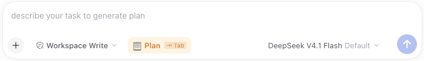
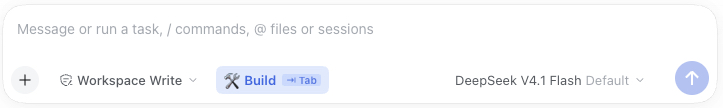

# @gaoyinxin/dsh-mode-switcher

English | [中文](README.zh.md)

Switch seamlessly between **Plan** and **Build** modes in DeepSeek Harness via `Tab` key or toolbar button like Claude Code, while automatically remembering each mode's model directly from the native model selector on the right.

## Features

- **Keyboard Shortcut Toggle**:
  - Press `Tab` at any time while typing in the composer (whether empty or with drafted text) to smoothly toggle between `Build` and `Plan` modes without losing draft text or cursor position.
  - Automatically yields to `@` mention and `/` slash command popup menus.
- **Unified Toolbar Button**:
  - Overrides the `conversation.input.plan` slot via priority shadowing (`priority: -10`), replacing the native one-way "Plan" close chip and preventing duplicate buttons.
  - Persistently displays `[ 🛠️ Build ⇥ Tab ]` / `[ 📋 Plan ⇥ Tab ]` status; click to toggle.
- **Seamless Per-Mode Model Memory (Uses Native Model Selector)**:
  - No extra settings button or modal needed — directly use the **native model selector on the right** of the composer.
  - Whatever model (and reasoning effort) you select while in **Plan** mode is automatically remembered as your **Plan mode model**.
  - Whatever model (and reasoning effort) you select while in **Build** mode is automatically remembered as your **Build mode model**.
  - Switching between `Plan` and `Build` modes (via `Tab`, button click, `/plan`, or plan approval) automatically restores the model for that mode.
- **Native Bilingual Support**:
  - Fully supports English and Simplified Chinese tooltips and accessibility labels, automatically adapting to the browser's display language.

## Screenshots

| Plan mode (amber) | Build mode (blue) |
|---|---|
|  |  |

The chip shows the mode you are in and switches to the other one when clicked or when `Tab` is pressed.

## Installation

### Method 1: Via DSH Plugin Market (Recommended)
1. In DeepSeek Harness Settings, navigate to **Plugins -> Discover**.
2. Click **Manage Index Sources… -> Add Index Source**.
3. Enter the market index URL:
   ```text
   https://gaoyinxin.github.io/dsh-mode-switcher/index.json
   ```
4. Search for **Mode Switcher** in the market list and click **Install**.

### Method 2: Via Command Line
```bash
dsh plugin add git+https://github.com/gaoyinxin/dsh-mode-switcher.git#v1.0.3
```
